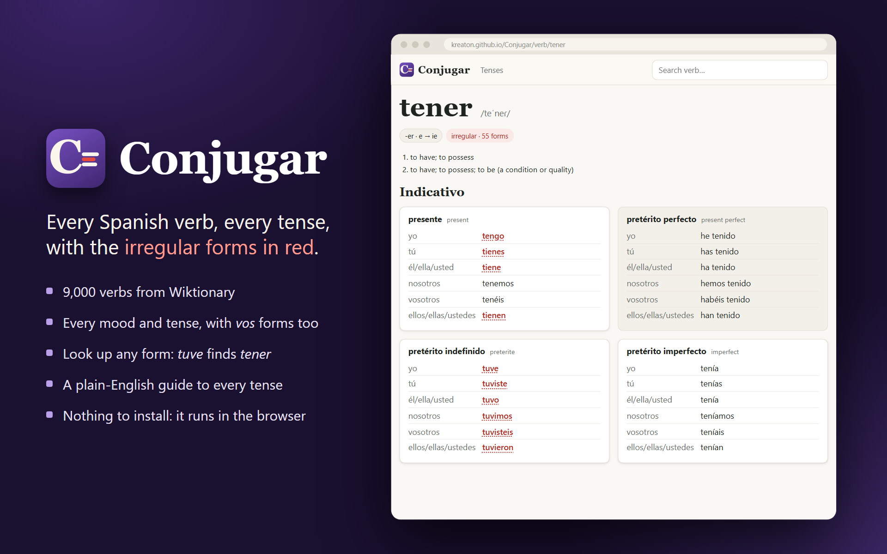

# Conjugar

[](https://kreaton.github.io/Conjugar/)
[](LICENSE)
[](#license--authorship)


[](https://github.com/kreaton/Conjugar/stargazers)

⭐ If Conjugar helps you with your Spanish, [star it on GitHub](https://github.com/kreaton/Conjugar). It's free, it's made by one developer, and stars are how other people find it.



**Conjugation tables for 9,000 Spanish verbs, with the irregular forms in red and every tense explained.**

**Open it: <https://kreaton.github.io/Conjugar/>**

Conjugar is the Spanish sister of [Coniuga](https://github.com/kreaton/Coniuga) (Italian) and is built
the same way.

Type a verb and you get its full table: all moods and tenses, the compound tenses with *haber*, the
infinitive, gerund and participle, definitions and pronunciation. Every form that doesn't follow the
regular pattern is shown in red, so *tengo, tienes, tuve* stand out from *tenemos, tenía*.

- **Search by infinitive or by any form.** Typing *tengo*, *fui* or *quepa* finds *tener*, *ir* and
  *ser*, and *caber*, and says which tense and person the form is.
- **Every tense, compound ones included.** All the indicative and subjunctive tenses, both forms of
  the imperfect subjunctive (*hablara / hablase*), the old future subjunctive, the conditional, and
  the affirmative and negative imperative (*¡habla! ¡no hables!*). Reflexive verbs get their pronouns
  (*me he lavado*, *¡lávate!*).
- **vos.** The voseo forms of Argentina, Uruguay and Central America (*vos hablás, ¡hablá!*) are one
  tick away.
- **Irregular forms in red.** Each verb is compared with the regular pattern of its conjugation, so you
  see exactly which forms you have to learn by heart, stem changes included (*pienso, puedo, pido*).
  The badge shows Wiktionary's class (*-ar · e → ie*) and counts the red forms.
- **The tenses explained.** The [tense guide](https://kreaton.github.io/Conjugar/guide) says in plain
  English what each mood and tense is used for, how the regular forms are built (with endings for
  *hablar*, *comer* and *vivir*) and gives example sentences. Every table on a verb page links to its
  section.
- **Nothing to install.** It's a static web app: the whole database is downloaded once (5.8 MB) and
  queried in the browser with SQLite compiled to WebAssembly. It can be installed as an app on
  Windows, Android and iOS.

## The data

The verbs come from [Wiktionary](https://en.wiktionary.org/), as extracted by
[kaikki.org](https://kaikki.org/) (wiktextract) and turned into SQLite by KaikkiVerbs, a separate tool
that builds the same kind of database for Italian, Spanish, Portuguese, French, German and Danish. The
app ships that database as it is (`src/Conjugar/wwwroot/data/verbs.sqlite.gz`, a copy of KaikkiVerbs'
`verbs-es.sqlite.gz`).

What the source has, and what it lacks:

- **Simple tenses only.** Infinitive, gerund, past participle, the nine simple tenses × six persons,
  and the affirmative and negative imperative. The compound tenses (*pretérito perfecto*,
  *pluscuamperfecto*, …) are not there; the app builds them with *haber*.
- **Every form in full.** Regular and irregular forms are stored the same way, with no flag saying
  which is which. Conjugar works that out itself (below).
- **The class**, from Wiktionary's table: the ending and the stem and spelling changes, `ar, e-ie, c-z`.
- **Notes on variants**: `vos`, a region (`spain`, `argentina, uruguay`), or `archaic`.
- **9,152 full tables and 33 alternative forms.** Reflexive verbs are entries of their own
  (*lavarse*), and their forms carry the pronoun (*me lavo*, *lávate*).

### What Conjugar adds for Spanish

`VerbDatabase` and `ConjugationBuilder` add:

- the compound tenses, the compound infinitive (*haber hablado*) and gerund (*habiendo hablado*), with
  the reflexive pronoun in front (*me he lavado*, *haberse lavado*);
- *no* in front of the negative imperative, which the source stores bare;
- a switch for the *vos* and regional forms, and one for the archaic ones;
- the regular/irregular marking, worked out per verb when it is first shown.

### Regular or irregular?

`RegularConjugator` generates the regular forms of *-ar*, *-er* and *-ir* verbs, with the spelling
changes grammars count as regular: *c → qu, g → gu, z → c, gu → gü* before *e* (*busqué, pagué,
empecé, averigüé*); *c → z, g → j, gu → g* before *a* and *o* (*venzo, cojo, distingo*); an unstressed
*i* between vowels becomes *y* (*leyó, leyendo*); and the written accent on a stressed *i* or *u*
(*envío, actúo, reúno*). Stem changes (*e → ie, o → ue, e → i, c → zc*) are what grammars call
irregular, so they come out red. Reflexive forms are compared without their pronoun, and without
accents where the attached pronoun moves it (*lávate*).

| Wiktionary's class | Verbs | Marked irregular |
|-------|------:|-----------------:|
| -ar | 5,686 | 9 |
| spelling changes only (*c → qu, g → gu, z → c, i → í*, …) | 2,015 | 10 |
| -er, no change given | 235 | 99 |
| -ir, no change given | 399 | 107 |
| stem changes (*e → ie, o → ue, e → i, c → zc*, …) | 751 | 748 |

The 9 red *-ar* verbs are *andar, estar, dar* and their compounds, and two old or rare verbs (*far*,
*miar*). Wiktionary names no stem change for many irregular *-er* and *-ir* verbs (*ser, hacer, poner,
decir, salir*, and the *-uir* verbs like *construir*), which is why those rows are half red. A verb
with no stem change and 30 or more red forms gets a warning on its page.

### The database

The KaikkiVerbs schema:

| Table | Holds |
|-------|-------|
| `verb` | infinitive, class, reflexive, auxiliary, alternative-form link (`lemma_id`), etymology, Wiktionary URL |
| `form` | one row per form: verb, tense, person, variant, value, note |
| `tense`, `person` | the tenses (Spanish and English names) and persons |
| `definition`, `example`, `pronunciation` | senses with their usage labels, example sentences, IPA |
| `meta` | source, date and licence |

It has 640,728 forms and comes to 19.6 MB, or 5.8 MB gzipped. The app inflates it into the in-memory
file system of the WebAssembly runtime and opens it read-only with `Microsoft.Data.Sqlite`. There is
no index on the form values: a full scan for the reverse lookup is fast enough.

To update the data, rebuild it with KaikkiVerbs (`download es`, then `build es`) and copy
`data/es/verbs-es.sqlite.gz` over `src/Conjugar/wwwroot/data/verbs.sqlite.gz`.

## Run

```powershell
dotnet workload install wasm-tools
dotnet run --project src/Conjugar
```

The app then runs at http://localhost:5044. The `wasm-tools` workload is needed because the native
SQLite library is linked into the WebAssembly runtime (`WasmBuildNative`).

## Icons

The app icon (iOS home screen, Windows/Android install via the web app manifest, and the browser
favicon) is drawn by a script into `src/Conjugar/wwwroot/icons` and `wwwroot/favicon.ico`:

```powershell
powershell -File tools\make-icons.ps1
```

The README banner (`images/banner.png`) is `tools/banner.html` rendered by headless Edge, using the
app's own stylesheet:

```powershell
powershell -File tools\make-banner.ps1
```

## Version

`Directory.Build.props` sets the version: Major.Minor by hand, and the patch is the GitHub Actions
run number (0 for local builds). The footer shows the version, build time and git commit.

## Deploy

`.github/workflows/deploy.yml` publishes to [GitHub Pages](https://kreaton.github.io/Conjugar/) on every
push to `main` (or manually from the Actions tab).

The app has real routes (`/verb/tener`, `/guide`), so the `<base href>` can't be relative: the
workflow sets it to `/Conjugar/` and copies `index.html` to `404.html`, so that deep links and reloads
work on GitHub Pages.

## License & Authorship

The code in this repository is distributed under the terms of the [MIT License](LICENSE).

The verb data (`src/Conjugar/wwwroot/data/verbs.sqlite.gz`) comes from
[Wiktionary](https://en.wiktionary.org/), via [kaikki.org](https://kaikki.org/), and is licensed under
[CC BY-SA 4.0](https://creativecommons.org/licenses/by-sa/4.0/), not MIT. If you reuse it, credit
Wiktionary and share it under the same licence. The compound tenses and the regular/irregular marking
are derived by Conjugar.

**AI authorship note:** Most of the source code in this repository was generated with AI coding agents (Claude Code), under my direction and review. Purely AI-generated material may not be eligible for copyright protection in some jurisdictions. To the extent any part of this project is protected by copyright, it is licensed under the MIT License, and the license's warranty and liability disclaimers apply to the project as a whole.

<!-- notices:start -->
### Independent development

Conjugar is an independent, personal project developed by Per Hejndorf. It is not affiliated with, endorsed by or sponsored by Microsoft, the Wikimedia Foundation or any other rights holder. Product names and logos are trademarks of their respective owners and are used only to identify the services and tools the project works with.

### Third-party notices and asset provenance

[THIRD-PARTY-NOTICES.md](THIRD-PARTY-NOTICES.md) lists every third-party library, data source and online service the project uses, with version, licence, source and whether it was modified. It also records where the icons and images came from and how they are licensed.
<!-- notices:end -->
